# Crypto Risk Lab

How risky is the crypto market really, where does that risk come from, and what happens to it in a crash?

This project measures **volatility**, **correlation structure** and **tail risk** across 30 major coins, using public data only (Binance daily candles since 2019, Deribit's DVOL implied-volatility index since 2021). Every forecast is made walk-forward, using only data available at the time.

## Key findings

| # | Finding | Evidence |
|---|---|---|
| 1 | **A basket of 30 coins behaves like about 1.5 independent bets.** Holding many coins is not diversification. | Effective number of bets (diversification ratio²), median 1.46 over rolling 90-day windows; one common factor explains 61% of all variance |
| 2 | **Correlation rises in sell-offs and falls in rallies.** On the worst 10% of days, alts move with BTC far more than a normal model predicts. | Exceedance correlation 0.59 on down days vs 0.26 expected; 0.18 on up days. Down-minus-up gap 0.40, block-bootstrap 95% CI [0.22, 0.51] |
| 3 | **The direction of BTC is unpredictable, the size of its moves is not.** Volatility clusters for weeks. | Autocorrelation of returns −0.07, of absolute returns +0.17; Ljung-Box p ≈ 10⁻⁶ |
| 4 | **GARCH beats a simple 30-day window, but not a simple EWMA.** | Diebold-Mariano t (QLIKE, range-based proxy) = −2.5 (BTC) and −2.4 (ETH) vs rolling window; −1.0 and −1.4 vs EWMA |
| 5 | **Options have usually priced more volatility than was delivered, but that premium is fading.** | DVOL above next-30-day realized by 8.4 vol points on average (Newey-West t 5.4); 18 points in 2021, 6-7 in 2023-2025, about zero in 2026 |
| 6 | **"High beta" does not mean "mostly BTC".** Alts move about 1.2× BTC, yet BTC explains only about 40% of their daily variance. | Median beta 1.18, median R² 0.39 (ETH 0.68, TRX 0.27) |
| 7 | **Normal-distribution risk models fail on crypto, even with up-to-date volatility.** | 99% VaR breached 1.5 to 2.2 times more often than promised (Kupiec p < 0.03 in all 6 cases); losses beyond VaR 14-24% worse than their Expected Shortfall predicted |
| 8 | **Volatility scaling plus an empirical or EVT tail gets it right.** | Filtered historical and EWMA + EVT pass the breach-count test for all three portfolios, with no significant clustering, and 97.5% Expected Shortfall within ±6% |

## 1. Volatility

### Volatility clusters

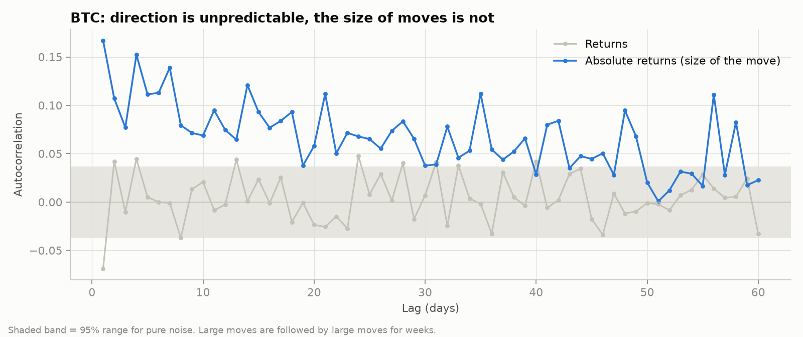

Returns themselves show almost no memory, but the **size** of returns does: a large move today makes another large move more likely for weeks. This is the basis for every volatility model below, and the reason position sizing should react to recent volatility.

### Which estimator to use

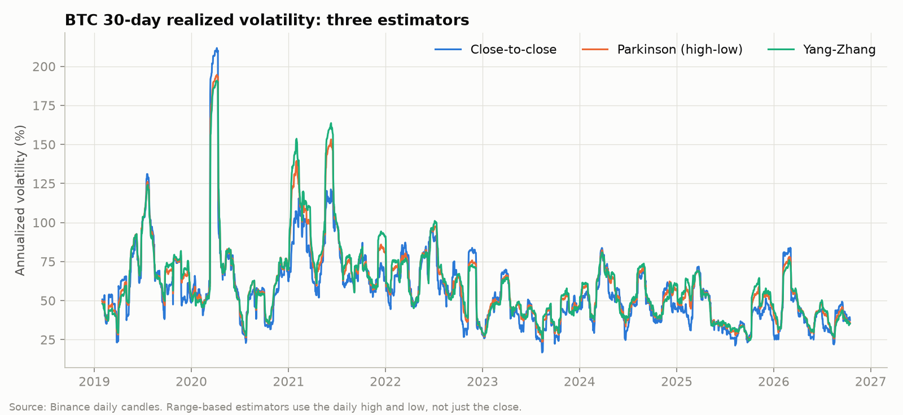

| Estimator | Uses | Noise vs close-to-close | Correlation with next month |
|---|---|---|---|
| Close-to-close | closes | 1.00 | 0.36 |
| Parkinson | high, low | 0.69 | 0.41 |
| Garman-Klass | open, high, low, close | 0.65 | 0.42 |
| Yang-Zhang | open, high, low, close | 0.69 | 0.42 |

Range-based estimators use the whole day's path, not just one price, so they are about 30% less noisy and slightly better at forecasting next month. They also run 3-5 vol points higher than close-to-close: crypto often reverses within the day, so the close understates how much the price actually travelled.

### Forecasting tomorrow's volatility

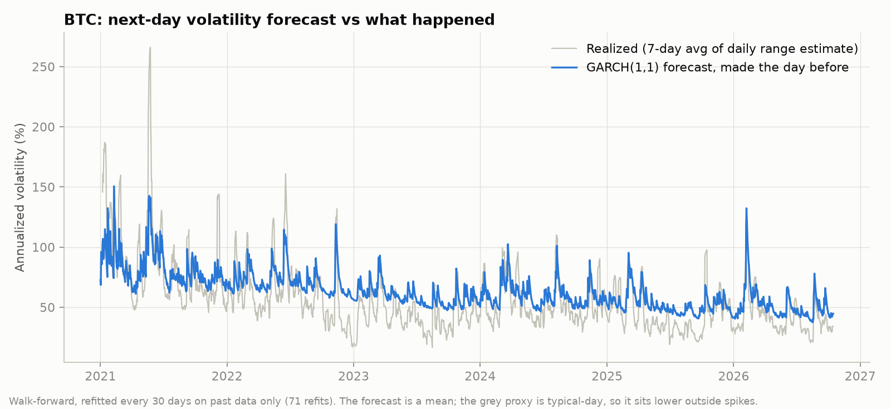

GARCH(1,1) was refitted every 30 days on past data only (71 refits, 2,114 out-of-sample days) and compared with EWMA (λ = 0.94, the RiskMetrics standard) and a 30-day rolling window. Losses use QLIKE, which ranks models correctly even with a noisy volatility proxy (Patton, 2011).

- GARCH is **significantly better than the rolling window** for both BTC and ETH.
- GARCH is **not significantly better than EWMA**. In practice, the simpler model is good enough.
- In the latest walk-forward fit, a BTC volatility shock has a half-life of about 17 days (persistence 0.96).

### Fat tails and slow-moving volatility, coin by coin

Fitting GARCH with Student-t errors to each coin's full history gives two consistent results:

- **Tails are extremely heavy.** The fitted degrees of freedom are 3 to 5 for almost every coin (BTC 3.0, ETH 3.2). Below 4, a distribution does not even have a finite kurtosis, so risk models built on the normal distribution are structurally wrong for crypto.
- **Persistence is close to 1 over the full sample** (BTC, BNB, DOGE and TRX hit the upper bound). This is a known effect: when the long-run level of volatility shifts, as it did with BTC falling from about 80% to about 45% annualized, a single GARCH model reads the shift as near-permanent persistence (Lamoureux and Lastrapes, 1990). That is why the forecasts above are refitted on a rolling basis rather than fitted once.

Full table: [`results/summary.md`](results/summary.md).

### Implied vs realized

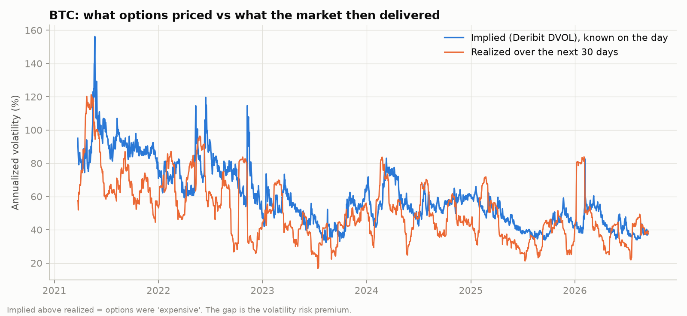

The gap between DVOL and the volatility that followed is the **volatility risk premium**: what option buyers pay for protection. It was positive on 72% of days, but the left tail is severe (worst −45 vol points), it has shrunk year after year, and in 2026 it has been about zero.

## 2. Correlation and market structure

### How many bets are you really holding?

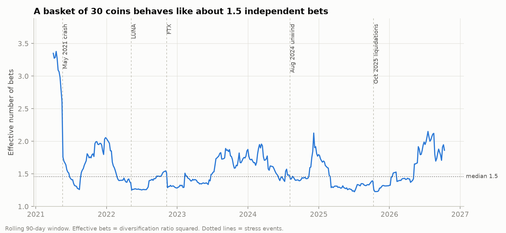

An equal-weight basket of 30 coins behaves like 1.2 to 2 independent positions most of the time. Diversification is lowest right after stress events (LUNA, FTX, the October 2025 liquidations), exactly when it would be needed.

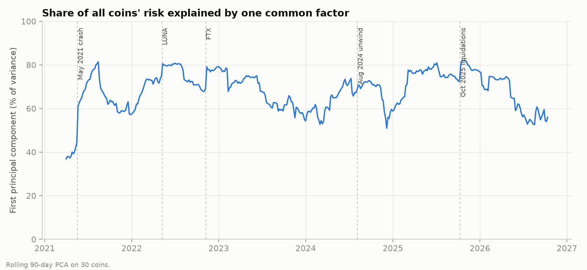

One common factor ("the crypto market") explains 61% of the variance of all 30 coins over the full sample, and 70% in a typical 90-day window. After stress events it rises to around 80%.

### Correlation in the tails

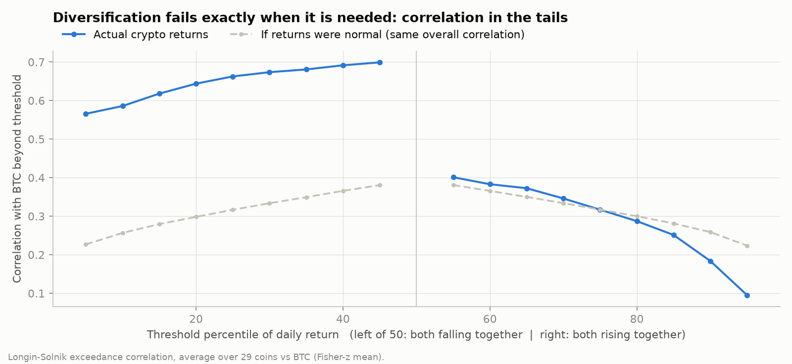

Exceedance correlation (Longin and Solnik, 2001) measures correlation only on days when both coins are beyond a threshold. The grey line is what a normal distribution with the same overall correlation would give. On the downside, crypto correlations are more than twice that benchmark; on the upside they are at or below it. **Correlation is asymmetric: it is highest exactly when prices are falling.** A moving-block bootstrap (10-day blocks, 300 resamples) puts the down-minus-up gap at 0.40 with a 95% interval of 0.22 to 0.51; none of the resamples came out below zero.

### Market risk vs coin-specific risk

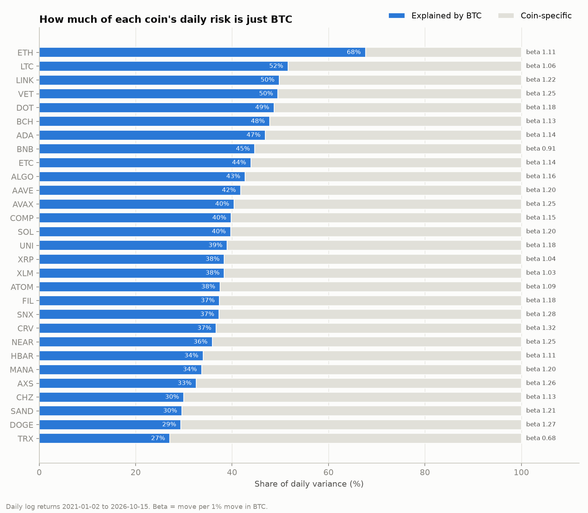

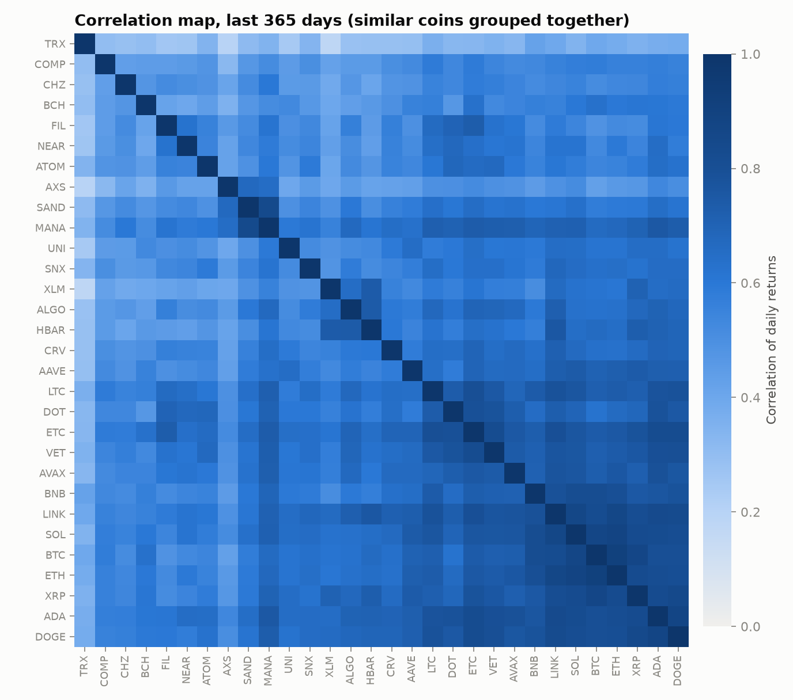

## 3. Tail risk: VaR and Expected Shortfall

Value at Risk (VaR) answers *"how much can I lose on a bad day?"*: with 99% confidence, tomorrow's loss will not exceed X. Expected Shortfall (ES) answers the follow-up: *"when that bad day comes, how much do I lose on average?"* Six models forecast both, one day ahead, for BTC, ETH and an equal-weight basket of 30 coins, using a 500-day window and only data available at the time. Each forecast is then checked against what happened.

### The tails

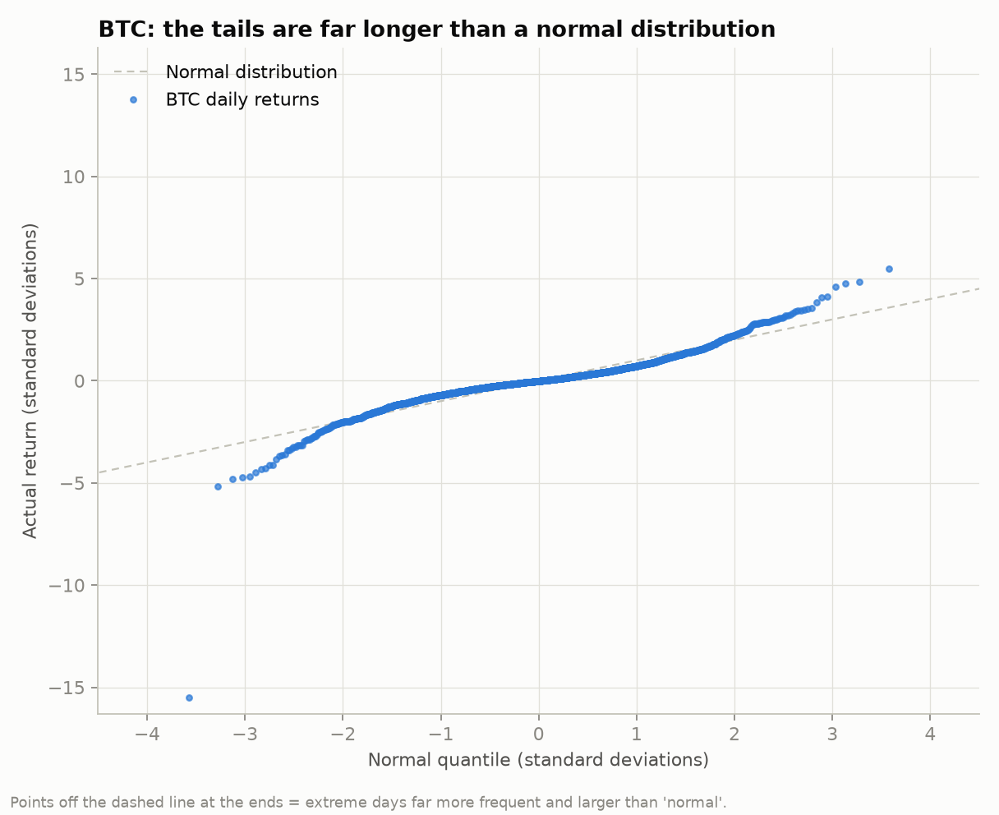

| | BTC | ETH | Basket |
|---|---|---|---|
| Down days beyond 4 standard deviations (volatility-adjusted) | 14 | 9 | 7 |
| Expected under a normal distribution | 0.09 | 0.09 | 0.07 |
| Down days beyond 5 standard deviations | 5 | 4 | 2 |
| Left-tail index (Hill estimator) | 2.6 | 2.6 | 2.7 |

A tail index below 4 means the fourth moment (kurtosis) does not exist, which agrees with the Student-t fits in Part 1. The isolated point at −15 standard deviations is 12 March 2020.

### Do the models tell the truth?

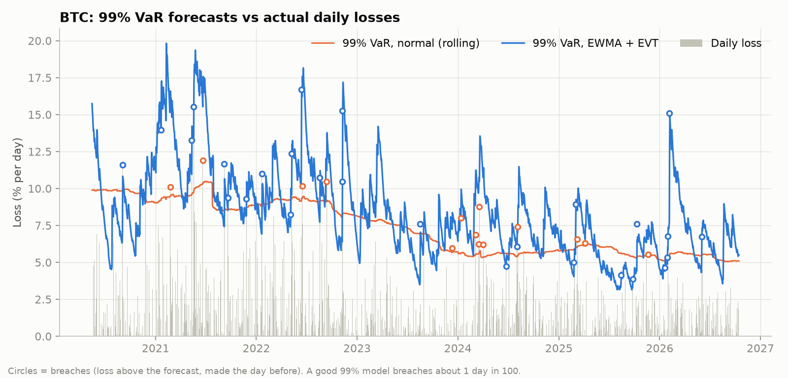

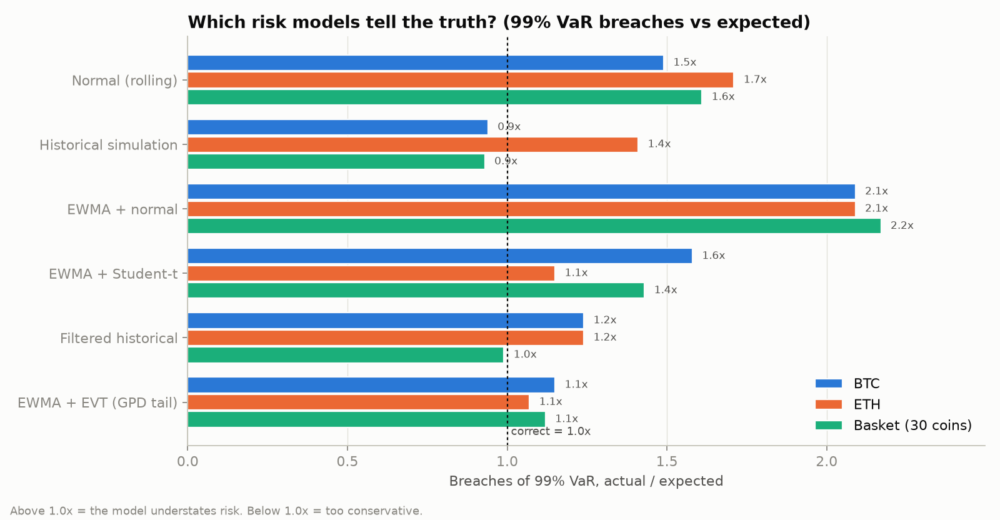

99% VaR, breaches as a multiple of what the model promised (Kupiec p-value in brackets):

| Model | BTC | ETH | Basket |
|---|---|---|---|
| Normal, rolling window | 1.49× (0.03) | 1.71× (0.002) | 1.61× (0.02) |
| EWMA + normal | 2.09× (0.00) | 2.09× (0.00) | 2.17× (0.00) |
| Historical simulation | 0.94× (0.76) | 1.41× (0.06) | 0.93× (0.77) |
| EWMA + Student-t | 1.58× (0.01) | 1.15× (0.47) | 1.43× (0.11) |
| Filtered historical | 1.24× (0.27) | 1.24× (0.27) | 0.99× (0.97) |
| **EWMA + EVT** | **1.15× (0.47)** | **1.07× (0.75)** | **1.12× (0.65)** |

What stands out:

- **Making a normal model react faster makes it worse.** EWMA + normal breaches about twice as often as promised. Tracking volatility is not enough when the shape of the tail is wrong.
- **Historical simulation gets the count right but the timing wrong.** For ETH and the basket its breaches cluster (Christoffersen p = 0.01 and 0.007): it adapts slowly, so bad days arrive in groups exactly when it is most needed.
- **Under the Basel traffic light**, EWMA + normal sits in the yellow zone in 73-81% of 250-day windows, and the rolling normal model hits red in 12% of windows for ETH and the basket. EWMA + EVT never reaches red (worst window: 6-7 breaches).

### When the bad day comes

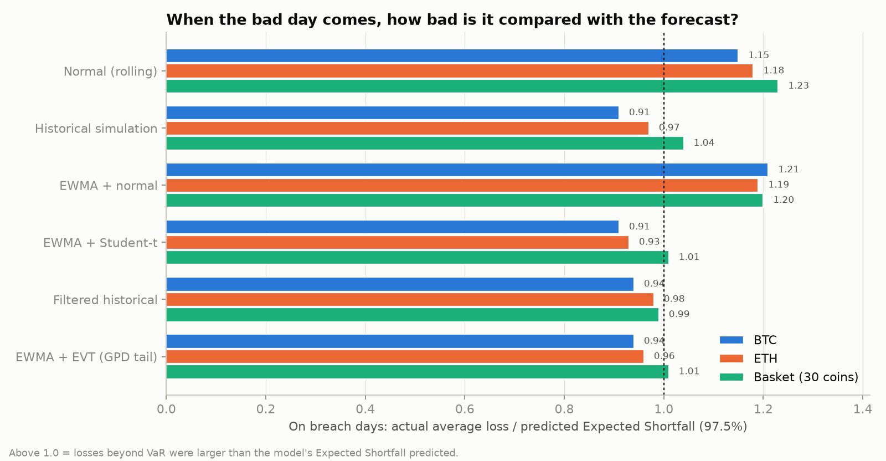

On days when 97.5% VaR was breached, normal models under-predicted the average loss by 15-23% (t-stats 3.2 to 4.7). Filtered historical and EVT were within ±6%, with no significant bias. Student-t models went the other way and slightly overstated it for BTC and ETH.

The full tables, including the 97.5% level, are in [`results/tail_summary.md`](results/tail_summary.md).

## What this means for risk management

1. **Count bets, not coins.** Risk limits should be set on exposure to the common factor, not on the number of positions.
2. **Use stress correlations, not average correlations.** A portfolio sized with average correlations will be under-hedged in a sell-off.
3. **Size positions by volatility, and update it.** Volatility is persistent and forecastable; a simple EWMA captures most of what is available.
4. **Do not use normal-distribution VaR for crypto.** It breaches 1.5-2× too often and under-predicts the size of the bad days. Combine a volatility filter with an empirical or EVT tail, and backtest it continuously.

## Method notes and limits

- Daily data; all statistics on log returns, annualized with 365 days (crypto trades every day).
- Walk-forward forecasts only; t-stats use Newey-West standard errors where observations overlap.
- **Survivorship bias:** only coins still listed on Binance today are included.
- DVOL data starts in March 2021; the 2026 figures cover a partial year.
- VaR/ES backtests: Kupiec (1995) for breach counts, Christoffersen (1998) for clustering, McNeil and Frey (2000) for conditional EVT and the ES check.
- Effective bets use the diversification ratio squared (Choueifaty and Coignard, 2008), an approximation.

## Run it

```bash
pip install -r requirements.txt
python crypto_risk_lab.py               # Parts 1 and 2: volatility and correlation (downloads public data)
python tail_risk.py                     # Part 3: VaR / ES models and backtests (uses the same data cache)
python crypto_risk_lab.py --synthetic   # quick check on fake data (also works for tail_risk.py)
```

All numbers in this README come from [`results/summary.md`](results/summary.md) and [`results/tail_summary.md`](results/tail_summary.md), which the scripts regenerate on every run.

---
*Code written with AI assistance. Research design, interpretation and conclusions are my own.*
